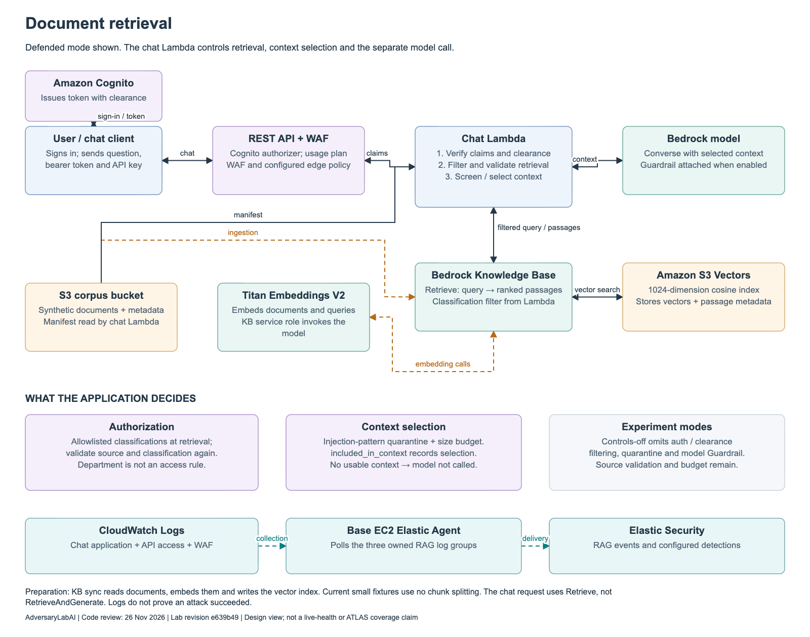
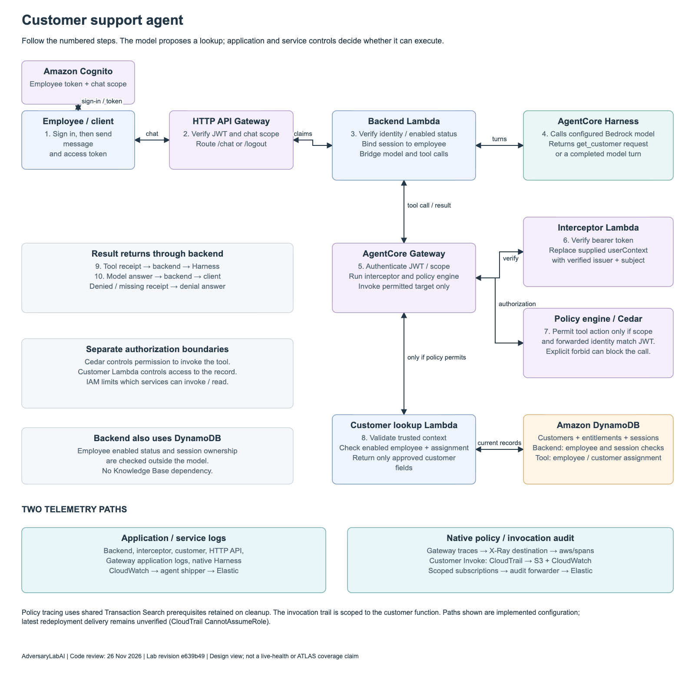
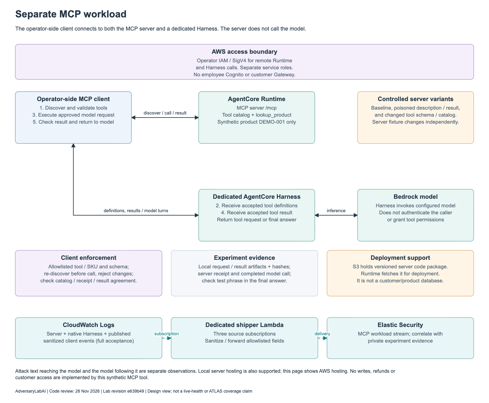

# What Would I Need to Investigate an AI Agent?

*How I designed AdversaryLabAI around three questions I wanted to answer in AWS and Elastic.*

When I read a technique in MITRE ATT&CK, I usually have two questions. How would I reproduce that behavior in my environment? If I did, what would show up in the logs?

I wanted to take the same approach to MITRE ATLAS. Take a customer support agent. An employee asks it to look up a customer. The request succeeds. If someone asked me tomorrow whether that employee received the customer’s record, what would I need to pull up in Elastic to answer them?

That question shaped how I built AdversaryLabAI. Before I picked the AWS services, I worked backward from the decisions I wanted to observe. I ended up with three small applications using synthetic data. Each gives me control over a different part of what happens between a user asking a question and a model returning an answer.

## Can I tell which documents made it into the model request?

I started with a chat app that answers questions from documents in S3. A Bedrock Knowledge Base searches those documents and returns relevant passages. I gave the chat Lambda responsibility for choosing which passages to send to the model. That gave me a place to record the decision for each passage while the request was being assembled.

Here’s what that bought me. In one request, the search returned five passages. Four were marked for inclusion. The fifth came from `Enso_Vendor_Onboarding_Memo.md`. It showed up in the search results, matched a configured injection check, and was logged with `action = quarantined_injection` and `included_in_context = false`. The application also recorded a successful model call under the same request ID.

If I’d logged only the filenames and the model status, I could have pulled up that request a week later and reasonably suspected the memo had been passed to the model. One field let me see what the application actually selected. It’s the field I’d want at hand if somebody asked, “Did our document chat use that memo?”

## Can I tell whether an employee received a customer record?

For the customer support agent, I gave the model one read-only tool. It can request a customer lookup. One tool was enough because even that simple operation involves two access decisions.

An employee signs in and asks about a customer. If the model requests a lookup, the backend calls AgentCore Gateway using the employee’s token. Gateway evaluates whether that employee can invoke the tool. The customer Lambda then checks the current assignment in DynamoDB to determine whether the employee can read that particular customer’s record.

Say an employee is allowed to use the lookup tool and asks for customer C-104. The tool can run and still return a denial because C-104 is assigned to somebody else. A Lambda invocation would look entirely reasonable in that sequence. I’d want the employee identity, the requested customer, the lookup result, and the application response before telling anyone what information was returned. That’s why I designed those decisions separately and gave myself a way to follow the request across them.

## What did the MCP client accept from the server?

The third workload is a Model Context Protocol (MCP) client and server. The server advertises one tool that looks up a synthetic product. The client discovers the tool, checks its definition, and supplies the accepted tool information to the model. If the model requests a lookup, the client calls the server and checks the result before passing it back.

I kept this separate from the customer agent because I wanted to change what the server supplied. I can keep the product and the question fixed, change the tool description, and compare what the server advertised with what the client accepted. I can also keep the description fixed and change the text returned by the lookup. Those are two different places where outside content can enter the interaction. Building the client gave me a way to examine each one.

## Getting the evidence into Elastic

The shared environment started with a VPC, an Ubuntu EC2 host, and Systems Manager for host access. I chose Elastic Security Serverless because the part I wanted to spend time on was the evidence. Running the SIEM myself would have added work without helping me answer any of those questions.

I still had to decide which events to collect and how they would get there. CloudTrail gives me the AWS API activity, VPC Flow Logs give me the network view, and Elastic Defend gives me the host activity. The EC2 collector also picks up the document chat’s CloudWatch logs. The customer agent and MCP workloads use dedicated Lambda shippers for their application logs. [Core logging diagram](assets/AdversaryLabAI-core.png)

The piece I’d carry into another project is the application logging. I can collect AWS telemetry after deciding which services to deploy. To answer why the document chat excluded a passage or why a customer lookup returned a denial, I have to capture the decision where the application makes it. An investigator coming along later gets whatever I chose to record there.

One limit matters for the customer lookup example. On the latest agent deployment covered by the architecture notes, the native Lambda invocation audit events failed delivery from CloudTrail to CloudWatch. That leaves a gap in independently confirming an invocation through that path. I’ve included the collection design and the observed limits in the [architecture walkthrough](assets/ARCHITECTURE.md).

I started this lab because I wanted to know what an investigator could reconstruct after an AI application handled a request. In the next piece, I’ll start with the document chat and follow one question through Elastic, from the five passages the search returned to the four the application selected.

See you in the next one 👋

Charles
