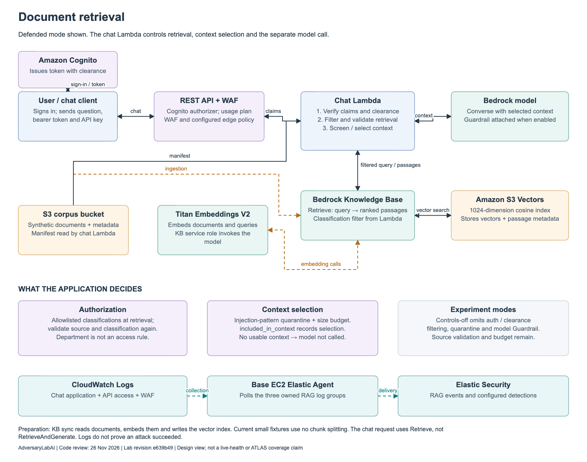
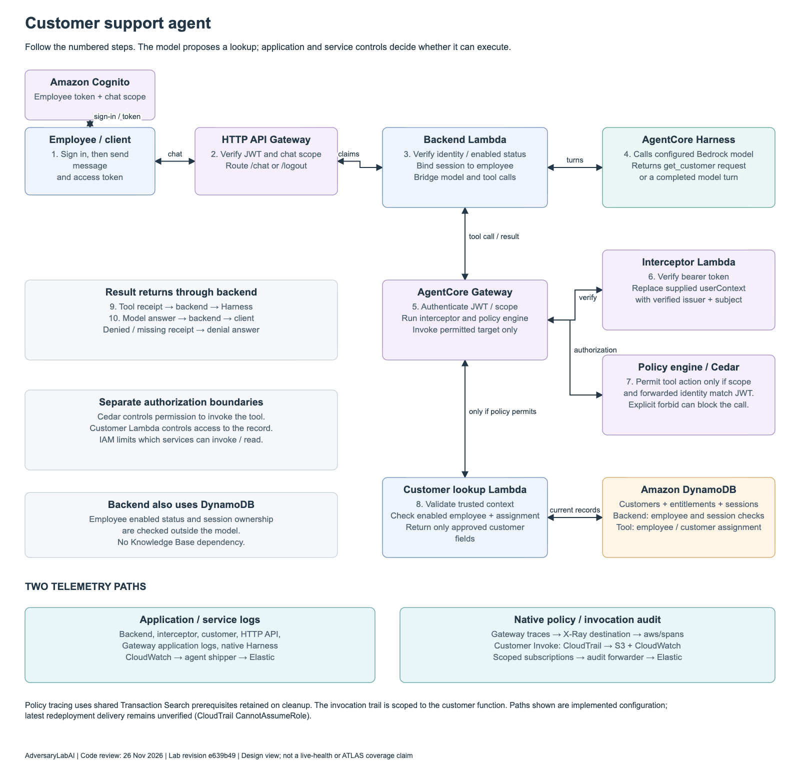
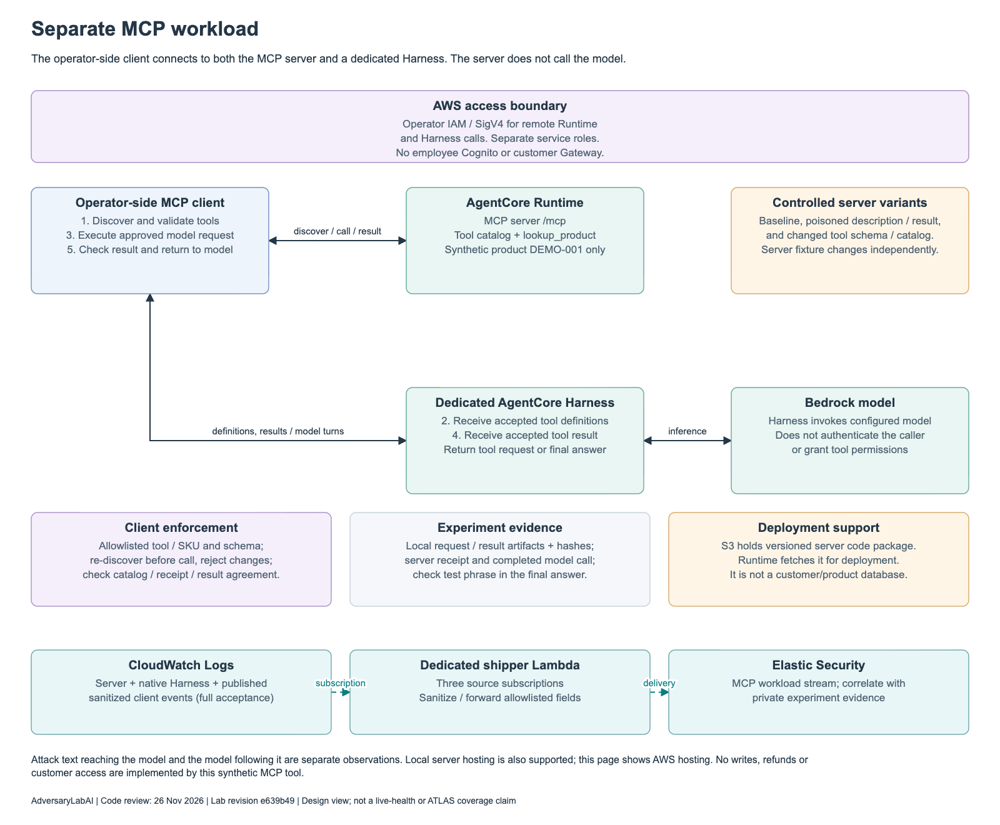
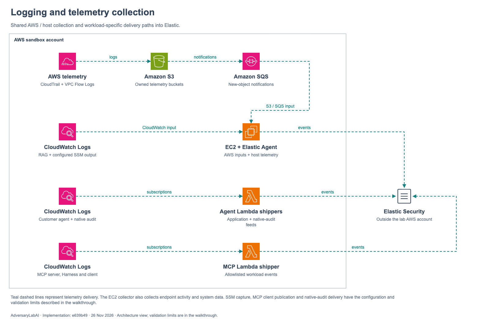

# You Gave Your AI Agent Access. Now Prove What It Did.

*Building an AWS and Elastic lab to test MITRE ATLAS techniques, trace application decisions, and find the limits of the evidence.*

An employee asks an AI agent to look up a customer. The application returns a response. If someone asked me tomorrow whether that employee received the customer’s record, what would I need to pull up in Elastic to answer them?

I’d want to follow the request through the tool call, the access decisions, and the returned result. To investigate that sequence, I need an application that makes those decisions and records enough detail to examine them afterward.

That’s where AdversaryLabAI starts. I’m taking the approach I use with MITRE ATT&CK and applying it to [MITRE ATLAS](https://atlas.mitre.org/): how would I reproduce the behavior, and what would show up in the logs?

The broader goal is to work through ATLAS technique by technique and map what each one would require in a lab. What infrastructure has to exist? Which part of the application do I need to control? What evidence could I collect, and where would visibility be limited? I started with three workloads that use synthetic data.

## Can I tell which documents made it into the model request?

I started with a chat app that answers questions from documents in S3. A Bedrock Knowledge Base searches those documents and returns relevant passages. I gave the chat Lambda responsibility for choosing which passages to send to the model. That gave me a place to record the decision for each passage while the request was being assembled.

This gives me a way to test indirect prompt injection: instructions embedded in a document the application retrieves. I can change the document, then follow whether its text was retrieved, selected for the model request, and reflected in the answer.

Here’s what that bought me. In one request, the search returned five passages. Four were marked for inclusion. The fifth came from `Enso_Vendor_Onboarding_Memo.md`. It showed up in the search results, matched a configured injection check, and was logged with `action = quarantined_injection` and `included_in_context = false`. The application also recorded a successful model call under the same request ID.

If I’d logged only the filenames and the model status, I could have pulled up that request a week later and reasonably suspected the memo had been passed to the model. The inclusion field showed what the application recorded as selected for the model request. I’d still check that record against the assembled request before treating it as proof of what the model received.

That example concerns a screening decision. A controls-off experiment, where the instruction is allowed through, answers a different question about the model’s response. I’ll keep those results separate as I work through the tests.

<!-- Publication check: Match the five retrieved passages, four inclusion decisions, memo quarantine, and successful model call to the same retained deployment and request. Confirm the control configuration; this example is distinct from the earlier controls-off RAG comparison. If available, add a cropped Elastic Discover result table from that same request here. Keep the query editor, raw prompts, and deployment/request IDs out of the published crop. -->

## Can I tell whether an employee received a customer record?

For the customer support agent, I gave the model one read-only tool. It can request a customer lookup. One tool was enough because even that simple operation involves two access decisions.

An employee signs in and asks about a customer. If the model requests a lookup, the backend calls AgentCore Gateway using the employee’s token. Gateway evaluates whether that employee can invoke the tool. The customer Lambda then checks the current assignment in DynamoDB to determine whether the employee can read that particular customer’s record.

Say an employee is allowed to use the lookup tool and asks for customer C-104. The tool can run and still return a denial because C-104 is assigned to somebody else. A Lambda invocation would look entirely reasonable in that sequence. I’d want the employee identity, the requested customer, the lookup result, and the application response before telling anyone what information was returned. That’s why I designed those decisions separately and gave myself a way to follow the request across them.

For the ATLAS tests, I can send a prompt that claims a different employee identity or asks for an unassigned record, then compare what the model requested with the identity and access decisions the application actually used.

## What did the MCP client accept from the server?

The third workload is a Model Context Protocol (MCP) client and server. The server advertises one tool that looks up a synthetic product. The client discovers the tool, checks its definition, and supplies the accepted tool information to the model. If the model requests a lookup, the client calls the server and checks the result before passing it back.

I kept this separate from the customer agent because I wanted to change what the server supplied. I can keep the product and the question fixed, change the tool description, and compare what the server advertised with what the client accepted. I can also keep the description fixed and change the text returned by the lookup. Those are two different places where outside content can enter the interaction. Building the client gave me a way to examine each one.

For tool-poisoning experiments, I can follow the altered description or result from the server through the client’s checks to the model request, then compare the model’s response.

## Getting the evidence into Elastic

The shared environment started with a VPC, an Ubuntu EC2 host, and Systems Manager for host access. I chose Elastic Security Serverless because the part I wanted to spend time on was the evidence. Running the SIEM myself would have added work without helping me answer any of those questions.

I still had to decide which events to collect and how they would get there. CloudTrail gives me the AWS API activity, VPC Flow Logs give me the network view, and Elastic Defend gives me the host activity. The EC2 collector also picks up the document chat’s CloudWatch logs. The customer agent and MCP workloads use dedicated Lambda shippers for their application logs. For each experiment, I still need to confirm that the relevant events arrived and that the identifiers connect the same request.

These three workloads give me a starting point. As I work through ATLAS, some techniques will fit what I’ve already built. Others will call for a different application or infrastructure, and some may leave little I can observe from inside the lab. I want the mapping to capture those limits, too.

That’s where the newsletter comes in. For the techniques I can test, I’ll use the lab to show what the test required, what I ran, and what actually showed up in Elastic.

See you in the next one 👋

Charles

