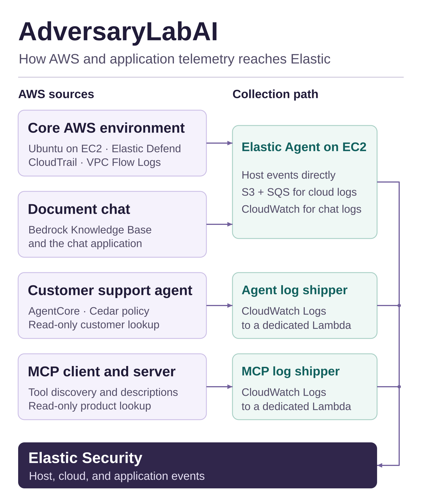

# Building an AI Security Research Lab with AWS and Elastic

*Why I built a document retrieval app, a customer support agent, and an MCP test environment to study MITRE ATLAS techniques.*

When I read a technique in MITRE ATT&CK, I usually have two questions. How would I reproduce that behavior in my own environment? And if I did, what would actually show up in the logs?

I wanted to take that same approach to AI security using MITRE ATLAS. Say an AI agent requests a tool. What does the application record about the request? Can I tell which user it was acting for, whether the tool ran, and what came back? How much of that could I piece together later in Elastic?

Before I could answer those questions, I had to build something that could produce the behavior in the first place. AdversaryLabAI grew out of that work. It includes a document retrieval app, a customer support agent, and a separate MCP server and client. I used synthetic data for all three and chose Elastic Security as the place to investigate activity across the lab.

## The core AWS environment

I started with a VPC, an Ubuntu host on EC2, and a way to get the logs into a SIEM. I chose Elastic Serverless because I wanted to spend my time on the research. For a lab this size, paying for a managed service made more sense to me than maintaining the SIEM myself. I still had to decide what to collect and give the collector permission to read it.

I use Systems Manager to access the host. If I want to know what ran there or which files a process touched, I start with Elastic Defend. If the question is which identity made an AWS API call, I look in CloudTrail. VPC Flow Logs give me a network view I can compare with the endpoint activity. The AWS logs land in S3, and Elastic Agent uses SQS notifications to pick them up.

That covers a fair amount of ground until I ask what happened inside an application. Take a tool backed by Lambda. An execution log can tell me the function ran. If I want to know which tool the agent requested, whose access the application checked, or whether it returned a record, I need the application to record those decisions. One thing I still want to verify is how much of that detail survives the trip from CloudWatch to Elastic.

## Why I chose these three workloads

I worked backward from the behaviors I wanted to study. To see what reached a model through document retrieval, I needed a chat app that selected passages. To follow an access decision, I needed an employee identity and a tool that checked it. For MCP, I wanted control over what a tool advertised and what it returned to a client. Those were concrete requirements I could build around.

**A chat app that searches documents.** Users sign in through Amazon Cognito and ask questions against a collection of synthetic documents in a Bedrock Knowledge Base. The documents have different access classifications. The application applies a filter based on the user’s clearance and records which passages it retrieves and which ones it includes in the model request. If a restricted document shows up in the search results, I can check whether its text made it into the request.

**A customer support agent with one tool.** An employee can ask the agent to look up a customer record. I kept that tool read-only because the part I wanted to study was the decision between the model requesting a lookup and the employee getting access to the record. The agent runs on Amazon Bedrock AgentCore. A Cedar policy at the gateway checks the employee’s assignment, and the lookup service checks it again before returning a record.

**An MCP server and client.** Model Context Protocol (MCP) gives me another part of tool use to study. Here the client discovers a product lookup tool from a server I control. I can change the description the server publishes or the content it returns, then compare what the server sent with what the client received. Giving this workload its own product catalog lets me change those details without also changing the customer support agent.

Building those capabilities gives me a starting point for a test. Take the customer lookup. An allowed request and a denied request give me a baseline for how authorization works. If I want to study a particular ATLAS technique, I still have to define the behavior that would count, record which controls are active, and decide what I’d compare across runs. Evidence that a tool received a request answers one question. I’d need a record of what came back to tell whether it returned customer data.

## Tearing it down and running it again

I built deployment, verification, and cleanup into the project because I wanted to run an experiment, tear the environment down, and come back to the same setup later. Terraform and a set of scripts handle that work. I ran the release checks across two deployments of the same build. For the chat app, I can filter by deployment ID and request ID in Elastic to find the exact run, even if I’ve asked the same question a dozen times.

I kept coming back to one question as I built the lab. If an agent requests a customer record, what would I need to see afterward to tell whether the employee actually received it? Working backward from questions like that helped me decide where each workload needed logging. It also gives me something concrete to check when I start comparing the behavior described in ATLAS with the evidence I can find in Elastic.

See you in the next one 👋

Charles
