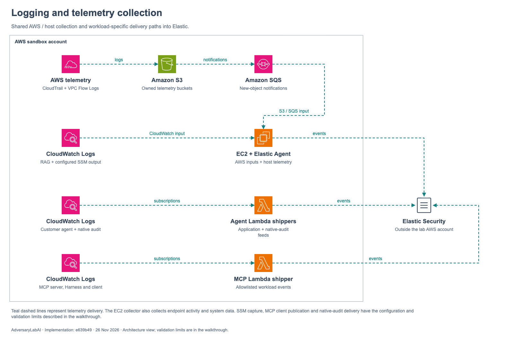

# Building an AI Security Research Lab with AWS and Elastic

*Why I built a document retrieval app, a customer support agent, and an MCP test environment to study MITRE ATLAS techniques.*

When I read a technique in MITRE ATT&CK, I usually have two questions. How would I reproduce that behavior in my own environment? And if I did, what would actually show up in the logs?

I wanted to take that same approach to AI security using MITRE ATLAS. Say an AI agent requests a tool. What does the application record about the request? Can I tell which user it was acting for, whether the tool ran, and what came back? How much of that could I piece together later in Elastic?

Those questions led me to build a lab using AWS and Elastic Security. AdversaryLabAI includes a document retrieval app, a customer support agent, and a separate MCP server and client. Each uses synthetic data and gives me a different part of an AI application's behavior to investigate.

## The core AWS environment

I started with a VPC, an Ubuntu host on EC2, and a way to get logs into a SIEM. I chose Elastic Security Serverless because I wanted to spend my time on the research instead of maintaining the SIEM. I still had to decide what to collect and give the collector permission to read it.

I use Systems Manager to access the host. If I want to know what ran there or which files a process touched, I start with Elastic Defend. If the question is which identity made an AWS API call, I look in CloudTrail. VPC Flow Logs give me a network view I can compare with endpoint activity. CloudTrail and VPC Flow Logs land in S3, and Elastic Agent uses SQS notifications to pick them up. The lab also collects configured Systems Manager shell-session transcripts and Run Command output through CloudWatch Logs.

Those sources do not explain every decision inside an application. A Lambda execution log can show that a function ran. To understand which tool the model requested, whose access was checked, or whether a customer record was returned, I need application events as well. I brought those events into Elastic alongside the AWS and endpoint telemetry.

## Why I chose these three workloads

I started by organizing MITRE ATLAS behaviors around the application capabilities needed to investigate them. Some needed documents supplied to a model. Others needed a model that could request a tool, an employee identity, and an access decision. Behaviors involving tool descriptions, returned content, and discovery changes led me toward a separate MCP server and client.

That gave each workload a research purpose. The mapping identifies experiments the lab might support; it does not mean I have reproduced every associated technique.

### A chat app that searches documents

The documents live in S3 and are indexed through a Bedrock Knowledge Base backed by S3 Vectors. The Knowledge Base handles ingestion and similarity search, while the chat Lambda controls which returned passages enter the model request. This gives me a retrieval pipeline to experiment with and a place to inspect the selection before calling the model.

With access controls enabled, users sign in through Cognito and the application filters retrieval by their clearance. It validates the returned sources, checks for configured injection patterns, and records passage identifiers, content hashes, and context-inclusion decisions. Those observations help distinguish a document being found from its text being supplied to the model. The pattern check is one control to investigate, not a general guarantee against prompt injection.

### A customer support agent with one tool

An employee can ask the agent to look up a customer record. AgentCore Harness handles the model interaction. When the model requests a lookup, the backend validates the request and calls AgentCore Gateway using the employee's token.

I chose Gateway to examine tool authorization separately from customer access. Its identity interceptor supplies verified employee context, and its policy engine evaluates Cedar rules for the tool call. Cedar is a language for writing authorization rules. It does not look up customer assignments in this application. The customer Lambda makes that separate decision using current employee and assignment records in DynamoDB.

That separation gives me specific boundaries to investigate: permission to use the application, permission to invoke the tool, and permission to read a particular customer. The tool is read-only, so the current workload focuses on lookup and access decisions.

### An MCP server and client

The server offers one synthetic product lookup tool. The client discovers its definition, checks it, and supplies accepted tool information to a dedicated Harness. When the model requests the tool, the client calls the server, validates the returned result, and supplies it back to the model.

Keeping the server separate lets me change a tool description, result, or catalog without changing the customer support agent. I can compare what the server published, what the client accepted, what was submitted to the model, and what appeared in the answer. Local hosting supports protocol experiments; deploying the server to AgentCore Runtime also lets me investigate the AWS authentication and logging paths. This workload uses operator IAM credentials rather than employee Cognito tokens.

## What I have tested so far

The experiments have been deliberately narrow:

- **RAG:** I compared a clean vendor memo with a poisoned version using the same question. The poisoned instruction was included in the model context, but its requested test phrase did not appear in the answer. Controls were disabled for both runs, so this was an instruction-delivery and answer comparison, not a test of authenticated access or the application’s document-quarantine check.
- **Customer agent:** Allowed and denied customer lookups exercised the employee access checks. In a separate comparison, employee-a requested an unassigned customer, then repeated the request while claiming to be employee-b. Both lookups used employee-a's verified identity and were denied by the customer function. The written claim did not change access on those requests.
- **MCP:** Baseline, description-poisoning, result-poisoning, and catalog-change cases exercised the client/server boundary. In the recorded poisoning runs, the injected content was delivered to the model, but the requested test phrases were absent from the answers. Separate checks exercised rejection of unapproved or changed tool definitions.

These results describe the recorded inputs, configurations, and responses. They are not a technique-coverage count or proof of protection against every variation of an attack.

## Following an experiment through the lab

For each experiment, I want to connect the application behavior with the available AWS telemetry. For a customer lookup, that means following the employee's request through the tool call, access decision, and returned result. A successful HTTP response or an isolated function log establishes only part of that sequence.

Deployment, request, session, and tool-call identifiers help me find the relevant records in Elastic. Retained experiment inputs and content hashes help identify which documents or tool results were involved. I still need to check the joins and collection path; the presence of those fields alone does not establish a complete account of what happened.

I also need to know which code, test data, and controls were in use. That brought deployment tracking, verification, recovery, and cleanup into scope. Terraform and scripts support those workflows. At an earlier revision, I recorded two deployment–test–cleanup cycles, including redeployment. That result belongs to that build.

A subsequent code audit identified gaps in cleanup recovery and request handling, along with cases where verification could accept inconsistent evidence or mistake an operational failure for an access denial. Those findings remain to be addressed. Newer agent logging integration also has an unresolved CloudTrail-to-CloudWatch delivery failure. Earlier successful runs do not establish that the current revision is fully validated.

In this series, I'll walk through the ATLAS behaviors behind these requirements, the AWS implementation choices, and what the experiments reveal about the available telemetry. The source code will remain private. I'll share architecture and sanitized examples, while keeping implemented behavior, observed results, and work still awaiting validation distinct.

The aim is to help other security engineers ask more precise questions about these applications: which events to collect, how to connect them, and what conclusions the evidence supports.

See you in the next one 👋

Charles
